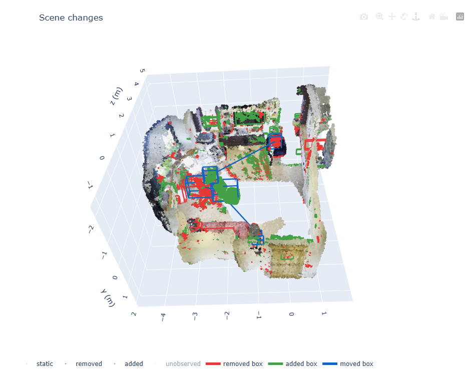
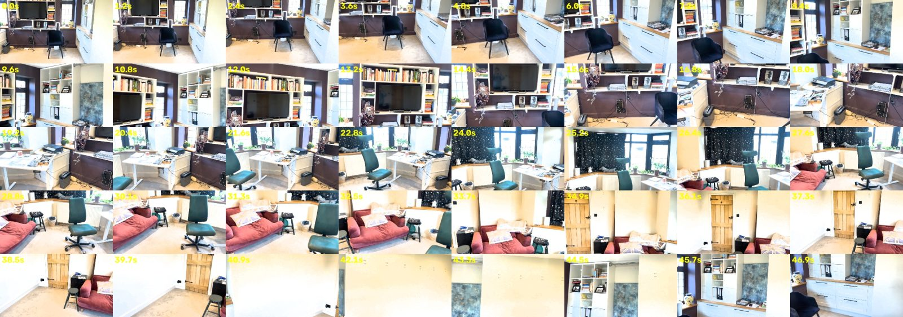
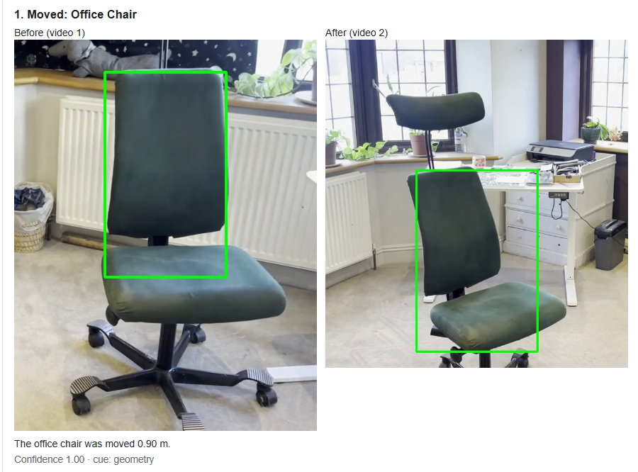
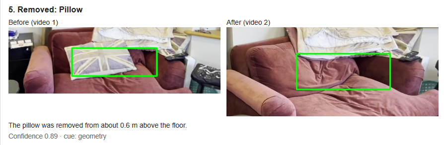
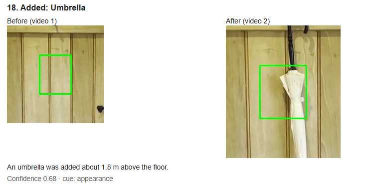

# What Changed in the Room?

Two phone videos of the same room go in. A shared metric 3D reconstruction comes out, with the objects that were moved, added, or removed, each labelled and shown in a 3D report.

On the example scene the system finds all three real changes: the flag pillow removed from the sofa, the desk chair moved 0.90 m into the room, and an umbrella added on the door. It also reports about thirty false changes. That gap, and what would close it, is covered at the end.



[](https://colab.research.google.com/github/ellecarey/humanoid/blob/main/notebooks/run_on_colab.ipynb)

## Run it

Open `notebooks/run_on_colab.ipynb` on a GPU runtime (40 GB or more for the full frame budget) and run the cells in order. Locally:

```bash
pip install -e ".[gpu,vlm]"
cp examples/scene_v1.mp4 data/raw_videos/scene_v1.MOV
cp examples/scene_v2.mp4 data/raw_videos/scene_v2.MOV
humanoid run --config configs/default.yaml
```

Open `outputs/demo/report/report.html`. Stages are cached: `--from-stage detect` retunes the vote on CPU, and `--from-stage describe` repeats only the labelling. No API key is required. CLIP runs locally. If `GEMINI_API_KEY` is set, Gemini is tried first and CLIP is the fallback.

## Result on the example videos

`examples/scene_v1.mp4` and `examples/scene_v2.mp4` are two handheld walks of the same room, taken in opposite directions after moving three objects.



| | |
| --- | --- |
| Alignment | 78% of video 2's points land within 5 cm of video 1. ICP applies a 4.6 cm, 0.6° correction at 1.3 cm RMSE. |
| The three changes | Pillow removed, about 0.6 m above the floor. Office chair moved 0.90 m. Umbrella added, about 1.8 m above the floor. |
| Everything else | CLIP keeps 36 of 67 proposed regions, which becomes 32 reported changes. |







`outputs/demo/debug/` holds the frame sheets, `alignment.json`, `detect.json`, the score histograms, and `labeler/verdicts.json` with the crop and the reason for every region.

## How it got here

**One model instead of a classical reconstruction stack.** The first design used SfM, monocular depth, scale alignment, and TSDF fusion to produce poses and depth, then a separate vision-language call per crop and a hand-weighted matcher to name and pair them. None of that had run on these videos, and a reviewer would have had to stitch several machines together to reproduce it. MapAnything replaced the whole reconstruction with one forward pass over both videos, and one Gemini call replaced the labelling and the matching. The part kept from that first design is the idea that a point is only "removed" when the other video can see through it.

**The whole walk, not one short burst.** A 12-frame, 3-second burst per video was small enough for a T4, but thumbnail matching picked a different corner of the room in each video. The reconstruction had 4 static points against 905,120 unobserved, and none of the three changes was in both. Sampling the sharpest frame every 0.5 s across the whole walk fixed the coverage. Overlap went to 0.78. The cost is a larger GPU: about 100 frames per video.

**Depth cannot see a flat object.** The umbrella hangs within a few centimetres of the door, inside the depth noise. Each point is now voted by every view from the other video as free, agreeing, or occluded, and an agreeing surface whose DINOv2 features differ counts as a change. The floor is chosen as the lowest horizontal plane rather than the biggest plane, because in this room the biggest plane is a wall. Before and after crops are taken from the same 3D box, so the label and the geometry refer to the same place.

**Gemini was replaced by a local model.** Gemini returned 503 and then 429, and a submission that only labels changes when a hosted model is available does not run. CLIP ViT-L/14 scores each crop, at two paddings, against a fixed indoor vocabulary. It rejects background, names the object, decides which visit a flat change belongs to, and pairs a removed region with an added one only when the label, the 3D size, and the appearance agree. Displacements and heights always come from the geometry. A closed umbrella cropped tight is labelled "vase"; with some door around it, CLIP calls it an umbrella at 0.97, which is why both paddings are tried.

## What is still wrong

The three real changes are found, with the right type and a usable label. The report around them is not credible yet: 32 changes, including a second "office chair moved 3.27 m", a scarf, a skateboard, and several monitors.

Raising CLIP's objectness threshold does very little, because the false regions score as high as the real ones. The umbrella's objectness is 1.0 and so is the scarf's. Requiring the two halves of a moved pair to look more alike breaks the real chair: at 0.85 similarity the desk view and the mid-room view stop pairing, and the chair comes out as a separate removal and addition. 0.75 is the highest value that keeps that pair.

The cause is earlier than CLIP. Detection still proposes 67 regions. Most are geometric, from depth noise and exposure, and those regions skip the check that asks whether the object is still there in the other video. That check exists only for appearance regions, because applying it to the pillow rejects the pillow: the bare sofa scores as "cushion" too. CLIP then has to name whatever is inside the box, and it always has an answer.

## What I would do next

1. Apply the other-video check to geometric regions, but judge it on the drop in probability for the chosen label rather than on "any object present". A wall that becomes a wall fails it. A pillow in front of other cushions needs a much lower bar, or it has to be exempted when the free-space vote is already strong.
2. Allow one moved pair per label, keeping the nearest. That removes the 3.27 m chair without touching the 0.90 m one.
3. Cut the 67 regions at the vote. The appearance counts barely moved when each video's mean feature was subtracted, so the exposure difference needs correcting on the images themselves, before the features are computed.