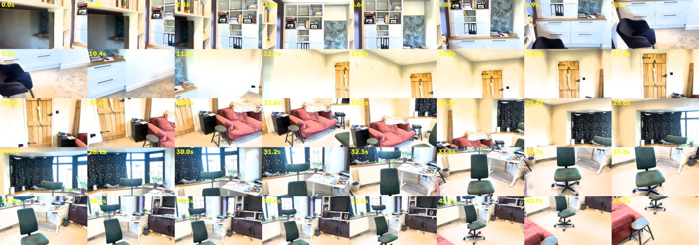

# What Changed in the Room? 3D change detection from two phone videos

Give it two phone videos of the same room, recorded at different times from different viewpoints. It builds one shared, metric 3D reconstruction and finds what was **moved, added or removed**. Each change is shown as a 3D box with before/after crops, a semantic label and a plain-English description. Everything runs locally; a cloud vision-language model is optional.

Built for the Humanoid Intern Challenge. The example scene has three changes:

| Change | Type | Where |
| --- | --- | --- |
| Union Jack (flag) pillow | removed | from the sofa |
| Green desk chair | moved | from the desk by the window into the middle of the room |
| Umbrella | added | hanging on the door |

[](https://colab.research.google.com/github/ellecarey/humanoid/blob/main/notebooks/run_on_colab.ipynb)


<!-- TODO: screenshot of outputs/demo/report/report.html -->

---

## Submission checklist

| They asked for | Where it is |
| --- | --- |
| A working codebase | `src/humanoid/`, one CLI command (`humanoid run`), 38 unit tests in `tests/` |
| Clear instructions to run it | [How to run](#how-to-run) and the one-click Colab notebook |
| Example inputs and outputs | [Example input and output](#example-input-and-output): videos in `examples/`, ground truth, real alignment and detection stats, the report |
| A short note on design choices and tradeoffs | [Design choices and tradeoffs](#design-choices-and-tradeoffs) |

| They care about | How this project addresses it | Details |
| --- | --- | --- |
| Simplicity and usability | One command, one config file, cached stages so you can retune on CPU, debug output from every stage, no API key needed | [Simplicity](#simplicity-and-usability) |
| Creativity in approach | A per-point free/agree/occluded vote, a DINOv2 appearance cue for flat changes, and CLIP (or Gemini) used as a verifier of geometric proposals rather than as a detector | [Creativity](#creativity) |
| Quality of spatial change detection | Metric reconstruction and ICP alignment (1.3 cm RMSE), occlusion-aware voting, exposure-invariant features, size checks on moved pairs | [Quality](#quality-of-spatial-change-detection) |
| Clear, compelling presentation | Interactive 3D report with colour-coded boxes, moved arrows, before/after cards and confidence | [Presentation](#presentation) |
| Coherence between changes, geometry and semantics | Geometry proposes regions and semantics verifies them. Labels must agree across a moved pair, and distances and heights always come from the geometry | [Coherence](#coherence-between-changes-geometry-and-semantics) |

---

## How to run

### Option 1: Colab (recommended)

1. Open [`notebooks/run_on_colab.ipynb`](notebooks/run_on_colab.ipynb) on a GPU runtime. An A100 or L4 works; 40 GB or more runs the full frame budget.
2. Run the cells in order. The notebook clones the repo, installs it, checks GPU memory, picks a frame budget, copies the example videos and asks for an optional `GEMINI_API_KEY`. Then it runs the pipeline and displays the debug output and the report.

To use your own videos, remove the examples, or upload two clips when the notebook asks: first the "before" video, then the "after" video.

### Option 2: local CUDA machine

```bash
git clone https://github.com/ellecarey/humanoid.git && cd humanoid
pip install -e ".[gpu,vlm]"            # or: uv sync --all-extras

mkdir -p data/raw_videos
cp examples/scene_v1.mp4 data/raw_videos/scene_v1.MOV
cp examples/scene_v2.mp4 data/raw_videos/scene_v2.MOV
# or point videos.v1 / videos.v2 in configs/default.yaml at your own files

humanoid run --config configs/default.yaml
```

The output goes to `outputs/demo/`. Open `outputs/demo/report/report.html` in a browser.

### Rerunning one stage

Every stage is cached, so you can repeat just part of the pipeline:

```bash
humanoid run --from-stage detect     # retune vote and cluster thresholds on CPU
humanoid run --from-stage describe   # retune the labeller or repeat the Gemini call
humanoid run --force                 # recompute everything
```

### Labelling: local CLIP by default, Gemini optional

With no API key, the `describe` stage uses **CLIP ViT-L/14 locally**. It verifies each region, labels it from a generic indoor vocabulary, and pairs moved objects. If `GEMINI_API_KEY` is set, Gemini (`gemini-3.8-flash`) does the same job from the same before/after crops. Gemini errors 429 (quota) and 503 (overloaded) are retried with backoff (10, 20 and 40 s). If Gemini still fails, the pipeline falls back to CLIP instead of crashing.

### Tests

```bash
pytest   # 38 CPU-only tests: frames, ICP, visibility vote, feature centring, floor and heights, crops, CLIP labelling (fake embedder), Gemini fallback, pairing, report
```

---

## Example input and output

### Input

`examples/scene_v1.mp4` (before) and `examples/scene_v2.mp4` (after) are 1280 px re-encodes of two handheld walks round the same room, about 47 s each. The walks go round the room in opposite directions, so most surfaces are seen from different viewpoints. The expected changes are listed in [`data/ground_truth/changes.json`](data/ground_truth/changes.json).

**Video 1 (before):** the chair is at the desk by the window, the flag pillow is on the sofa, and the door is bare.


**Video 2 (after):** the chair is in the middle of the room, the pillow is gone, and an umbrella hangs on the door.



### Output

```text
outputs/demo/
├── report/
│   ├── report.html     # interactive 3D scene + before/after card per change
│   ├── changes.json    # machine-readable changes (type, label, confidence, centroids, extent, height above floor)
│   └── scene.ply       # point cloud: static in RGB, removed red, added green, unobserved yellow
└── debug/
    ├── frames_v1.jpg, frames_v2.jpg   # selected frames: does each video cover the room?
    ├── alignment.json                 # how well the two videos landed in one frame
    ├── detect.json                    # point counts per label and every clustered region
    ├── scores.html                    # histograms of the free-space vote and appearance cosine
    ├── labeler/                       # CLIP crops per region and verdicts.json (label, objectness, why rejected)
    ├── gemini/                        # crops sent to Gemini and its raw JSON (when a key is set)
    └── ground_truth.json              # expected vs detected
```

**Alignment** (`debug/alignment.json`, real run on the example):

| Measure | Value |
| --- | --- |
| Share of video 2 points within 5 cm of video 1 | 0.79 before ICP, 0.78 after (target > 0.7) |
| ICP correction | 4.6 cm, 0.56° |
| ICP RMSE | 1.3 cm |
| Points re-observed by their own video | 96.5% (v1), 95.5% (v2) |

**Detection** (`debug/detect.json`, real runs). About 3.2 M points in total; 70–72% unchanged, 17–18% unobserved.

| Changed points | First run | After tuning (`appearance_cos` 0.4, `min_agree_views` 5) |
| --- | --- | --- |
| By geometry, v1 / v2 | 32.9 k / 51.6 k | 32.9 k / 51.6 k |
| By appearance, v1 / v2 | 141 k / 146 k | 34.0 k / 33.3 k |

Tuning cut the appearance false positives by about 4×, and left 63 candidate regions. Without a semantic check, those 63 regions became 37 "object" changes, 27 of them spurious "moved" pairs. That run is the reason the local CLIP verifier exists.

**CLIP verifier spot check.** Crops of the three real changes and of a plain-wall false positive were cut by hand from frames of the example videos and run through `interpret_regions` with the real model:

| Region given | Result |
| --- | --- |
| Pillow on sofa (geometry cue) | removed **cushion** "from about 0.6 m above the floor" |
| Umbrella region, deliberately given as "removed" (appearance cue) | flipped to added **umbrella** (objectness 0.999; P(umbrella) in the bare-door crop is 0.017 of the umbrella crop's) |
| Chair at desk + chair mid-room (geometry) | **office chair** moved 0.92 m "across the floor" |
| Plain white wall (appearance) | rejected as background (objectness 0.23) |

**Detected changes** (`report/changes.json`):

```json
// TODO: paste outputs/demo/report/changes.json from the latest Colab run
```

**Ground truth** (`debug/ground_truth.json`):

<!-- TODO: paste the latest result -->

**Report cards:**


<!-- TODO: screenshots of the three cards in report.html -->

---

## How it works


| Stage | What it does |
| --- | --- |
| `frames` | Splits each walk into 0.5 s windows and keeps the sharpest frame in each, giving about 90 per video. Near-duplicates are dropped. Blurry windows are dropped unless that would leave a gap of about a second, so views across plain walls still connect |
| `recon` | One [MapAnything](https://github.com/facebookresearch/map-anything) pass over **both** videos together (memory-efficient, bf16) gives metric depth, poses and confidence in one coordinate frame. Multi-scale point-to-plane ICP (5, 2 and 1 cm, robust loss) refines video 2 onto video 1. Points their own video does not see consistently are dropped as floaters |
| `features` | DINOv2 ViT-S/14 patch features for every frame, reduced to 64 dimensions with PCA |
| `detect` | Every 3D point is projected into every view from the **other** video. Each view votes **free** (it sees through where the point was), **agree** (same surface) or **occluded** (no information). Most votes free means a geometric change. Agreeing views whose features differ, after subtracting each video's mean feature, mean an appearance change. Too few useful views means unobserved |
| cluster | DBSCAN per video. The floor is the lowest plane perpendicular to gravity (gravity estimated from the camera poses). Each region gets its height above the floor and a score from its votes. Co-located removed/added appearance regions are merged into one flat change |
| `describe` | Best before (v1) and after (v2) view of each region's 3D box. **CLIP** scores the crop at two paddings against about 55 object and 25 background classes. It rejects background, flips flat changes to the side that holds the object, labels, and pairs removed/added halves that share a label, size and look. **Gemini**, if available, does the same from the same crops |
| `report` | Interactive Plotly 3D scene, before/after cards with confidence, `changes.json`, `scene.ply` |

---

## How this meets what you care about

### Simplicity and usability

- **One command, one config.** `humanoid run` and `configs/default.yaml`. Every threshold is in that file, with a comment.
- **No API key, no cloud.** Reconstruction, detection and labelling all run on one GPU; Gemini is an optional upgrade. When Gemini fails (quota, overload), the run doesn't fail with it.
- **Cached stages.** The GPU-heavy reconstruction runs once. Detection thresholds retune on CPU in seconds (`--from-stage detect`); labelling thresholds retune with `--from-stage describe`.
- **Debug output from every stage.** Frame sheets, alignment stats, label counts, score histograms, and for each region the exact crops CLIP or Gemini saw and why the region was kept or rejected. When something goes wrong, you can see which stage caused it.

### Creativity

- **A visibility vote instead of a point-cloud distance.** A nearest-neighbour difference can't tell "removed" from "not seen this time". Here every point asks each view from the other video whether it can see *past* the point. Removed and unobserved become separate outcomes, and occlusion counts as no evidence rather than as change.
- **Two complementary cues.** Depth catches objects with volume, like the chair and the pillow. The umbrella hangs flat on the door, within depth noise of it. DINOv2 features catch it because the surface is at the same depth but looks different. Subtracting each video's mean feature stops a global exposure difference from looking like a change everywhere.
- **Semantics as a verifier, not a detector.** CLIP or Gemini never search the images for changes. Geometry proposes 3D regions; the model sees the same 3D box from both visits and decides whether there's an object, what it is, and which visit it belongs to. For flat changes, that last question is one the geometry alone cannot answer.
- **Context-adaptive crops.** The labeller scores each crop at two paddings and keeps the one it's surest about. A closed umbrella on its own looks like a vase to CLIP (0.37 vase vs 0.18 umbrella); with a little door around it, CLIP calls it an umbrella (0.97).

### Quality of spatial change detection

- **Shared metric frame.** Both videos go through one joint reconstruction, then ICP makes a 4.6 cm, 0.6° correction with 1.3 cm RMSE.
- **Viewpoint and occlusion.** Occluded views are ignored. A geometric change needs at least 3 free views *and* a free share of at least 0.6 of the informative views. The depth margin grows with distance, `max(4 cm, 2.5% × depth)`.
- **Incomplete observations.** Points with too few informative views are labelled *unobserved* and drawn in yellow, not counted as removed.
- **Noise.** A same-video consistency filter removes floating points. Appearance changes need at least 5 agreeing views, so one badly exposed frame can't trigger them. Clusters need 150 points, and must sit above the floor plane picked by gravity (in this room the largest plane is a wall).
- **Moved objects.** A pair must agree in sorted 3D extent within `max(15 cm, 30%)`, share a label, and have CLIP embeddings at least 0.75 similar.

### Presentation

- An **interactive 3D report** (`report.html`, self-contained). Static geometry in real RGB, removed in red, added in green, unobserved in yellow. Boxes mark each change, and a line joins the before and after positions of a moved object.
- **A card per change**, sorted by confidence: before and after crops side by side, a one-line description in room terms (for example "moved 0.92 m across the floor", "about 0.9 m above the floor"), the confidence and the cue that found it.
- `changes.json` for downstream use, for example by a robot planner, including height above the floor; `scene.ply` for MeshLab or Open3D.

### Coherence between changes, geometry and semantics

- Every label belongs to a **3D region**, and the semantic model only sees regions the geometry found, through crops of that region's 3D box.
- **Confidence combines both sides:** the region's vote strength (free-space share or appearance difference) times CLIP's objectness.
- A **moved pair** needs both geometric agreement (size) and semantic agreement (same label, similar look).
- **Numbers come from geometry, words from semantics.** Displacements and heights above the floor are measured; the labeller only names the object. Gemini is told not to give distances.
- **Where geometry is ambiguous, semantics decides.** In a flat appearance change, the geometry can't tell whether the umbrella or the bare door is "the object". The side where CLIP (or Gemini) sees an object sets added versus removed.

---

## Design choices and tradeoffs

**A learned feedforward reconstruction instead of classical SfM.** An earlier version used COLMAP-style SfM with per-video depth alignment and TSDF fusion. On a white-walled room with handheld video it was fragile and slow. MapAnything predicts metric depth and poses for all frames in one pass, with both videos in the same frame from the start. *Tradeoff:* it needs a large GPU (about 200 frames on 40 GB in memory-efficient bf16).

**Frames across the whole walk, not short bursts.** To fit a T4, the first version reconstructed one 3-second burst per video, matched by thumbnail similarity. On plain white walls that matching picked *different corners of the room* in each video. The result was 4 static points against 905,120 unobserved, and none of the three changes appeared in both reconstructions. Sampling the sharpest frame every 0.5 s over the whole walk fixed it (overlap 0.79). *Tradeoff:* more frames need a bigger GPU.

**Voting instead of a distance threshold.** It costs one projection per point per view, but it separates changed, unchanged and unobserved, which a distance threshold can't.

**The appearance cue is necessary but noisy.** Without it, the umbrella is invisible. With it, the first run flagged about 141 k points per video, mostly because video 1 is more overexposed than video 2. Three layers bring that down: mean-centred features, stricter thresholds, and semantic verification. Even then, appearance regions are the ones CLIP is asked to double-check against the other video. Geometric regions are only checked for being background, because free space is already direct evidence.

**CLIP locally by default, Gemini optional.** Gemini returned 503 (overloaded) and then 429 (quota exhausted) during development, so a solution that depends on it isn't robust. CLIP with a fixed vocabulary is deterministic, free and offline. *Tradeoffs:* its labels are coarser ("cushion", not "Union Jack cushion"), and a pillow on a sofa is a hard case because the sofa's own cushions look similar. That's why only appearance regions get the "is it still there" test. The vocabulary is generic COCO/LVIS indoor classes, not tuned to this scene.

**Thresholds were tuned on this one scene.** `appearance_cos`, `min_agree_views`, `min_points` and the labeller thresholds were set from this scene's debug output and a hand-cut crop check. They're likely to need retuning for very different rooms; `scores.html` and `labeler/verdicts.json` show where to set them.

## Limitations and next steps

- Locate ground-truth changes in 3D so the check compares positions, not just labels and types.
- Use a small local vision-language model (for example Qwen2.5-VL) with the Gemini prompt, for richer labels without the cloud.
- Exposure-normalise the frames themselves (not just the features), for cleaner report crops.
- Mesh or Gaussian-splat output, for a nicer report than a point cloud.

---

## Repository structure

```text
humanoid/
├── configs/default.yaml              # every threshold, commented
├── data/ground_truth/changes.json    # flag pillow removed, desk chair moved, umbrella added
├── docs/                             # README figures
├── examples/                         # scene_v1.mp4, scene_v2.mp4 (1280 px)
├── notebooks/run_on_colab.ipynb
├── src/humanoid/
│   ├── cli.py                        # humanoid run, stage caching
│   ├── preprocessing/                # frame extraction and window selection
│   ├── reconstruction/               # MapAnything, ICP + self-consistency, DINOv2 features
│   ├── change_detection/             # NN pre-filter, visibility vote, clustering, matching
│   ├── semantics/                    # best views, CLIP labeller, Gemini, descriptions
│   ├── visualisation/report.py       # report.html, changes.json, scene.ply
│   └── utils/                        # geometry, debug outputs
└── tests/                            # 38 CPU tests
```
